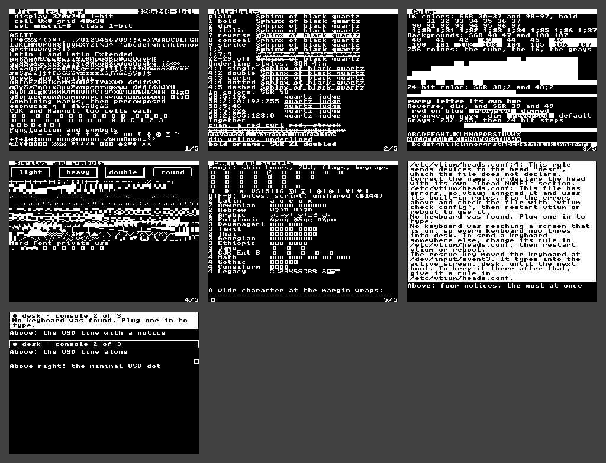

# 320x240-1bit

A 1-bit 320x240 panel, such as an SSD130x OLED or a memory LCD: 320x240, 1-bit, drawn in `unscii-8` at 8x8, 40x30 cells, the card on 5 screens and vtium's message bars on two more, shown together in the collage.



| Display | Class | Cell | Grid | Font | Screens |
|---|---|---|---|---|---|
| 320x240, 1-bit | 1-bit | 8x8 | 40x30 | `unscii-8`, built in | [screen-1.png](screen-1.png), [screen-2.png](screen-2.png), [screen-3.png](screen-3.png), [screen-4.png](screen-4.png), [screen-5.png](screen-5.png), [screen-6.png](screen-6.png), [screen-7.png](screen-7.png) |

## Why this font

A 1-bit panel lights a pixel or does not, so a bitmap font, 1-bit already, draws on it exactly: the built-in Unscii-8 at 8x8 gives the same 40x30 cells as the color profile, for the reasons that profile gives. vtium-render maps each cell's colors to lit or unlit by the cell, never by brightness, with polarity from the default background, and cuts every coverage at half (#135): colors show only where a cell's background differs from the default, dim draws as plain text, and the shades draw as ordered patterns.

## Configuration

[vtium.conf](vtium.conf):

```ini
# A panel the platform does not report as 1-bit takes the key.
display-depth=1
font-size=0
```

The console chooses this set by itself once #126 and #118's rule land; the screens here draw vtium-font's built-in set directly.
