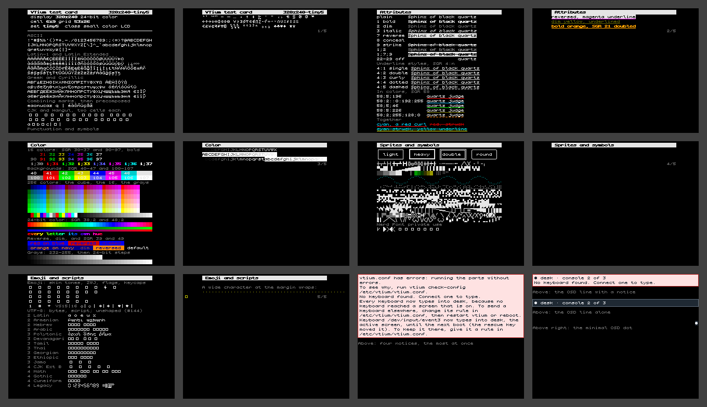

# 320x240-tiny5

minspec's display floor, a 320x240 SPI panel, in the example frit tiny5: 320x240, 24-bit color, drawn in `tiny5` at 6x9, 53x26 cells, the card on 10 screens, each block on 2, and vtium's message bars on two more, shown together in the collage.



| Display | Class | Cell | Grid | Font | Screens |
|---|---|---|---|---|---|
| 320x240, 24-bit color | small color LCD | 6x9 | 53x26 | `tiny5`, the frit [`tiny5.vtfrit`](https://github.com/vtium/vtium/blob/main/crates/vtium-config/frits/tiny5.vtfrit) | [screen-1.png](screen-1.png), [screen-2.png](screen-2.png), [screen-3.png](screen-3.png), [screen-4.png](screen-4.png), [screen-5.png](screen-5.png), [screen-6.png](screen-6.png), [screen-7.png](screen-7.png), [screen-8.png](screen-8.png), [screen-9.png](screen-9.png), [screen-10.png](screen-10.png), [screen-11.png](screen-11.png), [screen-12.png](screen-12.png) |

## Why this font

This profile shows an example of the smallest font, the frit `tiny5`, which is provided as an optional configuration .vtfrit profile. vtium's own choice for this display is the built-in Unscii-8 at 8x8, which the profile `320x240` shows; a person who wants `tiny5` installs the frit and its font by hand and names it in `font-name`. Tiny5 Mono, a pixel font whose capitals are 5 pixels tall, draws at its own 6x9 cell, which gives this display 53x26 cells where the built-in Unscii-8's 8x8 gives 40x30: a third more columns, for four fewer rows. It holds ASCII, Latin-1, code page 437, Greek, Armenian, box drawing, blocks and Braille, 4,882 characters in all, so most of the card's text draws in it; vtium's sprites draw the box drawing, blocks and Braille. vtium ships the frit `tiny5` (#217) and never the font, so a machine needs Tiny5 Mono's BDF file installed by hand, as the frit's comment says. Its grid is shorter than one of the card's 40x30 blocks, so each block takes two screens here: its first 26 rows, then its title again and its last 4 rows. A character Tiny5 Mono lacks draws on these screens as the font's missing glyph, as CJK, Hangul and emoji do here. The console draws such a character in the built-in Unscii-8 where Unscii-8 holds it, centered in the 6x9 cell with a column cut off each side (ADR-1200 D7), which these screens, drawn from the frit's glyphs alone, do not show.

## Configuration

[vtium.conf](vtium.conf):

```ini
# The frit tiny5: crates/vtium-config/frits/tiny5.vtfrit in
# /etc/vtium/fonts, with Tiny5 Mono's BDF file installed where its
# source= line says. It draws at its own 6x9 cell.
font-name=tiny5
font-size=0
```

The screens here draw the glyphs vtium-config's engine, the one the helper runs (ADR-1301 D2), generates from the shipped frit and Tiny5 Mono's BDF file, pinned by commit and SHA-256, which `make specimens-fonts` fetches, with the frit's `source=` line pointed at the fetched copy (`tools/specimens/README.md`); where that file is absent the check skips this profile while it is provisional, and fails it once accepted.
