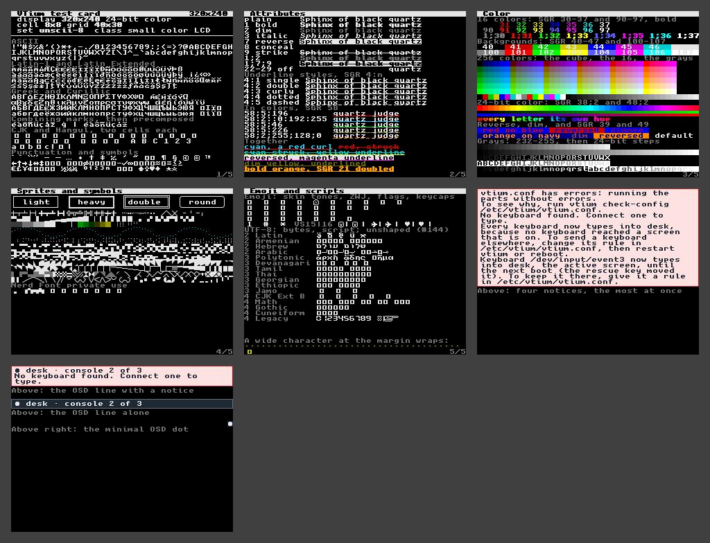

# 320x240

minspec's display floor, a 320x240 SPI panel: 320x240, 24-bit color, drawn in `unscii-8` at 8x8, 40x30 cells, the card on 5 screens and vtium's message bars on two more, shown together in the collage.



| Display | Class | Cell | Grid | Font | Screens |
|---|---|---|---|---|---|
| 320x240, 24-bit color | small color LCD | 8x8 | 40x30 | `unscii-8`, built in | [screen-1.png](screen-1.png), [screen-2.png](screen-2.png), [screen-3.png](screen-3.png), [screen-4.png](screen-4.png), [screen-5.png](screen-5.png), [screen-6.png](screen-6.png), [screen-7.png](screen-7.png) |

## Why this font

vtium draws the built-in Unscii-8 in character cells under 16 pixels high. See [the issue that builds Unscii-8 into vtium](https://github.com/vtium/vtium/issues/107). With `font-size=0`, vtium takes the font's own smallest height where 16-pixel cells would leave fewer than 80x25 of them. See [the issue that sets the size `font-size=0` picks](https://github.com/vtium/vtium/issues/118). So vtium draws this display in 8x8 cells with no font keys at all. That is the most text the display holds at a size a person can still read. It costs no disk, because the built-in fonts are part of the vtium binary. Unscii-8 holds no CJK characters, no Hangul, no emoji and none of the private-use symbols, so those draw as the missing glyph, U+25A1. See [the issue about small-panel fonts that cover more](https://github.com/vtium/vtium/issues/307). In a zh, ja or ko locale, vtium draws the built-in unifont at 16 pixels instead.

## Configuration

[vtium.conf](vtium.conf):

```ini
# vtium's defaults: font-size=0 picks 8 pixels here, which
# draws the built-in Unscii-8.
font-size=0
```

The console chooses this font by itself. The screens here draw vtium-font's built-in font directly.
