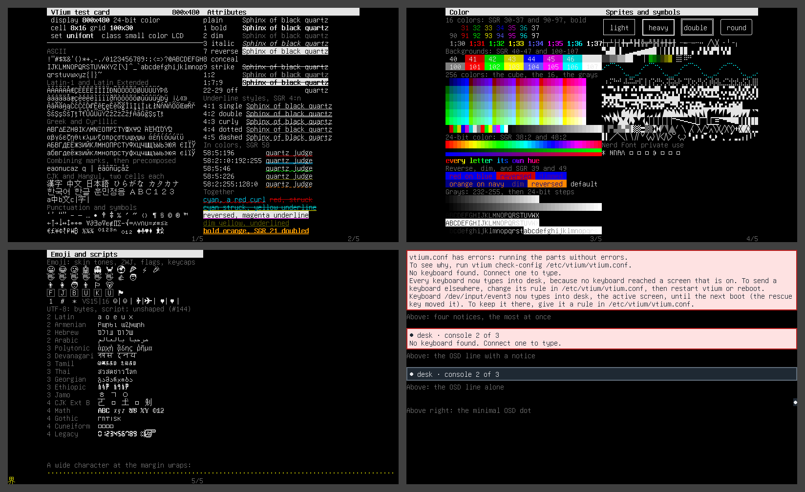

# 800x480

A 7-inch panel, as on the Raspberry Pi touch display: 800x480, 24-bit color, drawn in `unifont` at 8x16, 100x30 cells, the card on 3 screens and vtium's message bars on one more, shown together in the collage.



| Display | Class | Cell | Grid | Font | Screens |
|---|---|---|---|---|---|
| 800x480, 24-bit color | small color LCD | 8x16 | 100x30 | `unifont`, built in | [screen-1.png](screen-1.png), [screen-2.png](screen-2.png), [screen-3.png](screen-3.png), [screen-4.png](screen-4.png) |

## Why this font

16-pixel cells leave at least 80x25 cells here, so `font-size=0` keeps its 16 pixels. See [the issue that sets the size `font-size=0` picks](https://github.com/vtium/vtium/issues/118). From 16 pixels, vtium draws the built-in unifont: 8x16 cells for Latin, Greek and Cyrillic, and 16x16 for CJK and Hangul, which it covers in full. See [the issue that builds unifont into vtium](https://github.com/vtium/vtium/issues/15). It costs no disk, because the built-in fonts are part of the vtium binary. Emoji draw as unifont's monochrome glyphs where it has one, and Nerd Font symbols draw as the missing glyph. The outline profiles draw both from the desktop font set.

## Configuration

[vtium.conf](vtium.conf):

```ini
# vtium's defaults: font-size=0 picks 16 pixels here, which draws
# the built-in unifont.
font-size=0
```

The console chooses this font by itself. The screens here draw vtium-font's built-in font directly.
