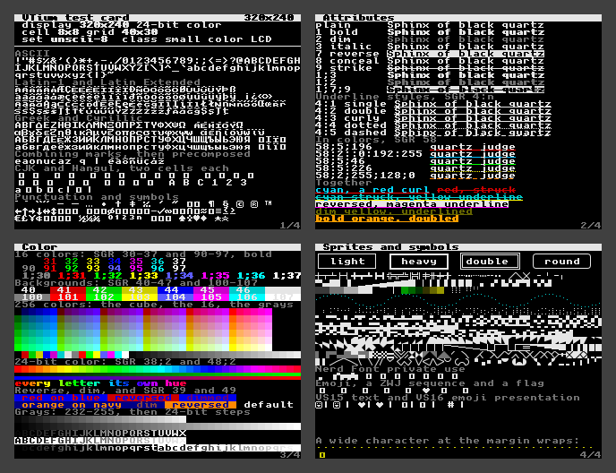
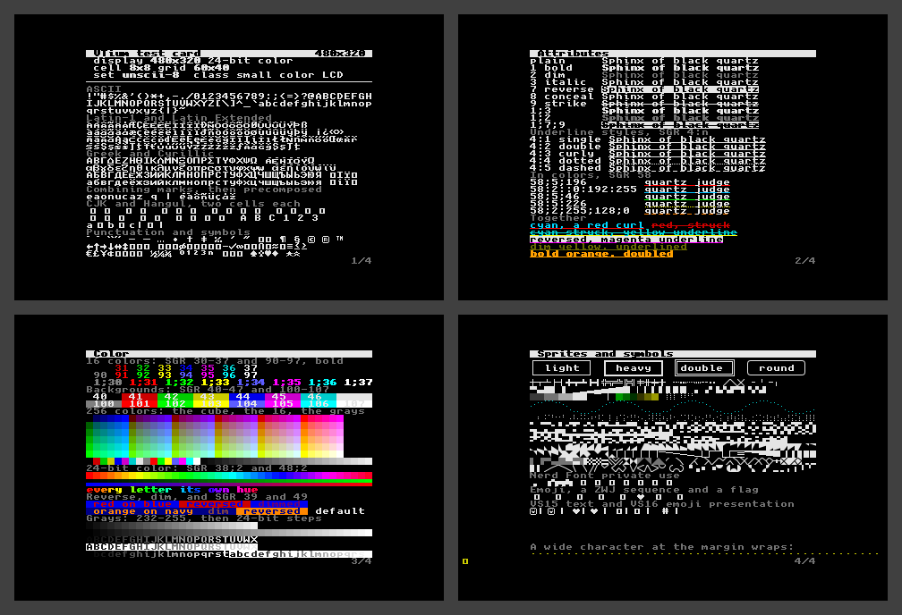
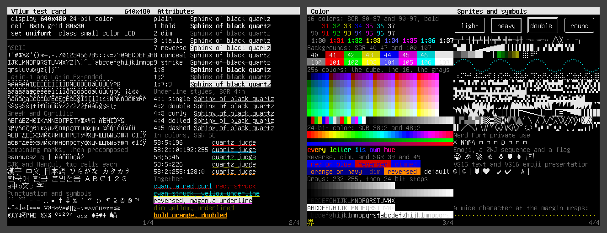
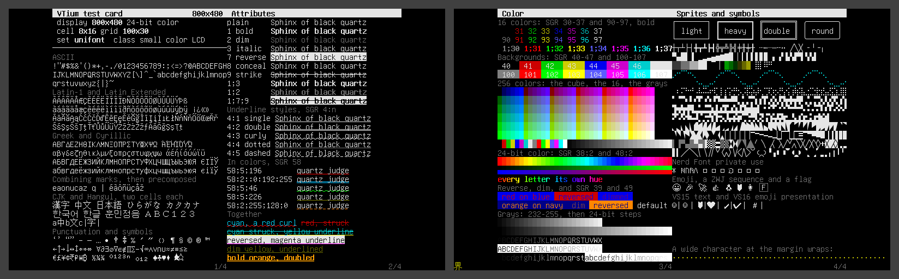
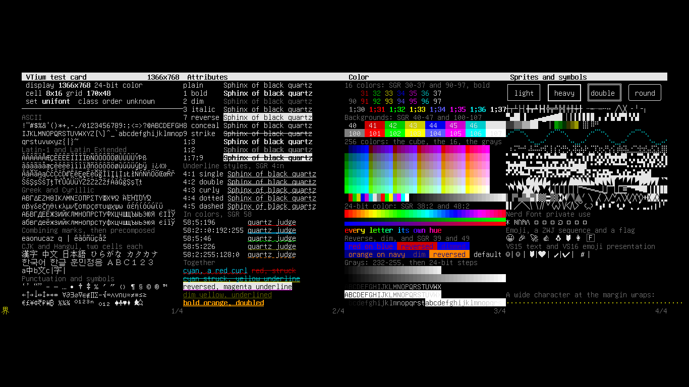
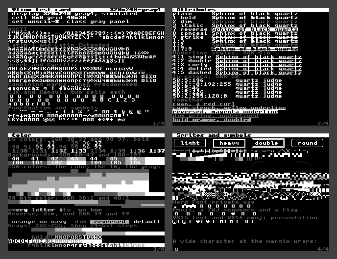
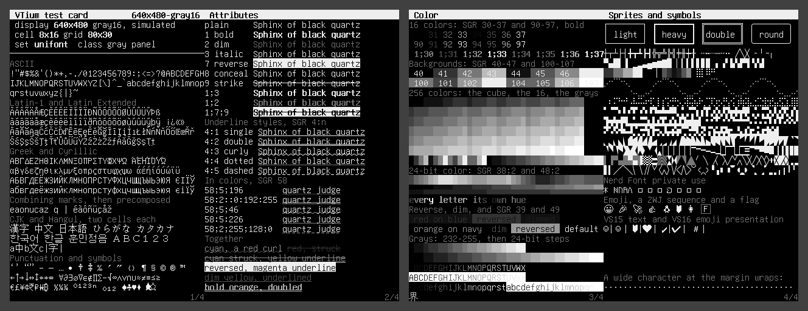

# VTium specimens

vtium's test card, drawn by vtium's renderer in memory for each display profile, from a 1-bit 320x240 panel up to a 2560x1440 monitor (#142). Each profile's directory holds the screens, the collage where the card takes several, the font and configuration vtium uses there and why, and its vtium.conf.

| Profile | Depth | Cell | Grid | Font | Screens | Status | Preview |
|---|---|---|---|---|---|---|---|
| 320x240-1bit | 1-bit | | | Unscii-8, 8x8 | | pending #135 | |
| [320x240](320x240/) | 24-bit color | 8x8 | 40x30 | `unscii-8` | 4 | provisional |  |
| [480x320](480x320/) | 24-bit color | 8x8 | 60x40 | `unscii-8` | 4 | provisional |  |
| [640x480](640x480/) | 24-bit color | 8x16 | 80x30 | `unifont` | 2 | provisional |  |
| [800x480](800x480/) | 24-bit color | 8x16 | 100x30 | `unifont` | 2 | provisional |  |
| [1366x768](1366x768/) | 24-bit color | 8x16 | 170x48 | `unifont` | 1 | provisional |  |
| 1920x1080 | 24-bit color | | | an outline font at 24 pixels | | pending #23, #126, #141 | |
| 2560x1440 | 24-bit color | | | an outline font at 32 pixels | | pending #23, #126, #141 | |

A pending profile waits on the issues it names. A provisional one is drawn and judged, and waits on the operator's review; `provisional.tsv` lists them.

## Gray panels, simulated

vtium draws a gray panel exactly as a color display, and the panel's driver converts each pixel (#135). These renders take vtium's color drawing through that conversion, as Linux v7.3's drivers make it, to show what such a panel shows. They are simulations, not vtium's output, and judge nothing.

| Profile | Depth | Cell | Grid | Font | Screens | Status | Preview |
|---|---|---|---|---|---|---|---|
| [320x240-gray4](simulated/320x240-gray4/) | gray4, simulated | 8x8 | 40x30 | `unscii-8` | 4 | simulation |  |
| [320x240-gray16](simulated/320x240-gray16/) | gray16, simulated | 8x8 | 40x30 | `unscii-8` | 4 | simulation |  |
| [640x480-gray16](simulated/640x480-gray16/) | gray16, simulated | 8x16 | 80x30 | `unifont` | 2 | simulation |  |

## The card

The card is one byte stream of vtium's own, written by `tools/specimens`, in four blocks of 40x30 cells. A block is one 320x240 screen at 8x8, and a page holds as many blocks as its grid fits, centered:

1. Text
2. Attributes
3. Color
4. Sprites and symbols

`tools/specimens/README.md` lists what the card leaves out and why.

## Drawing and judging

`make specimens` draws every file here from the profile table. `make specimens-check`, and `cargo test` through `tools/specimens/tests/`, draw them again and fail on any difference from what is committed, `simulated/` aside: an image by its pixels, a text by its bytes, and a file here that the table does not draw. A change that moves a specimen fails until the moved files are committed, each in a commit of its own that lists what moved.
