# VTium specimens

vtium's test card, drawn by vtium's renderer in memory for each display profile, from a 1-bit 320×240 panel up to a 2560×1440 monitor. See [the specimens issue](https://github.com/vtium/vtium/issues/142). Each profile's directory holds the screens and their collage, the font and configuration vtium uses there and why, and its vtium.conf.

| Profile | Depth | Cell | Grid | Font | Screens | Status | Preview |
|---|---|---|---|---|---|---|---|
| [320x240-1bit](320x240-1bit/) | 1-bit | 8×8 | 40×30 | `unscii-8` | 7 | accepted | [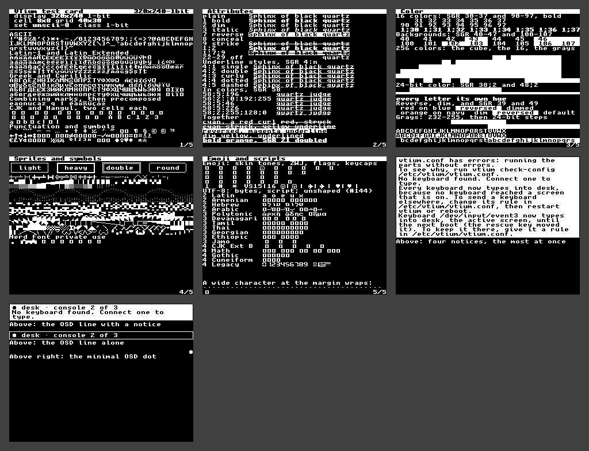](320x240-1bit/collage.png) |
| [320x240](320x240/) | 24-bit color | 8×8 | 40×30 | `unscii-8` | 7 | accepted | [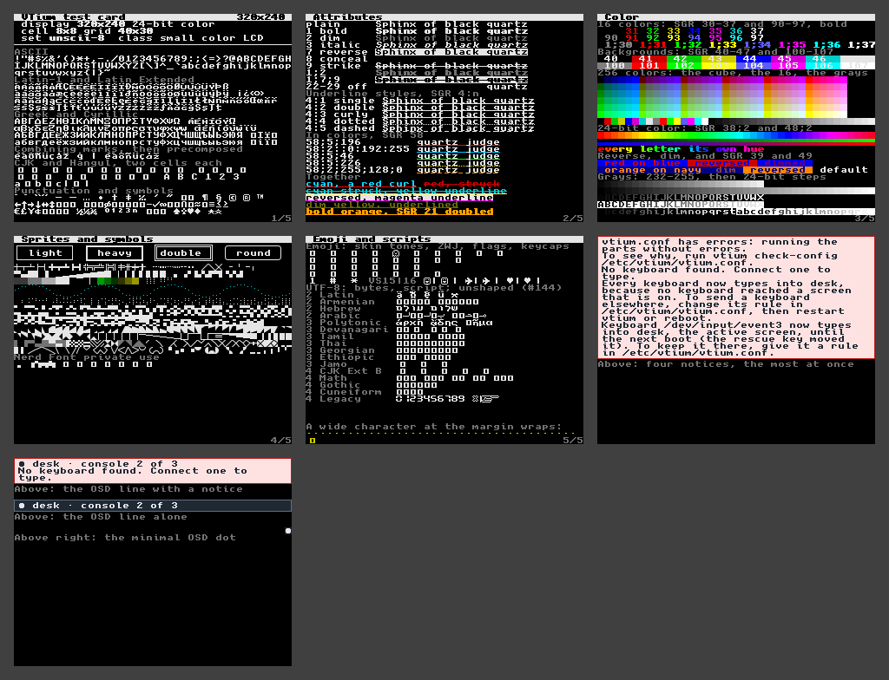](320x240/collage.png) |
| [320x240-tiny5](320x240-tiny5/) | 24-bit color | 6×9 | 53×26 | `tiny5` | 12 | accepted | [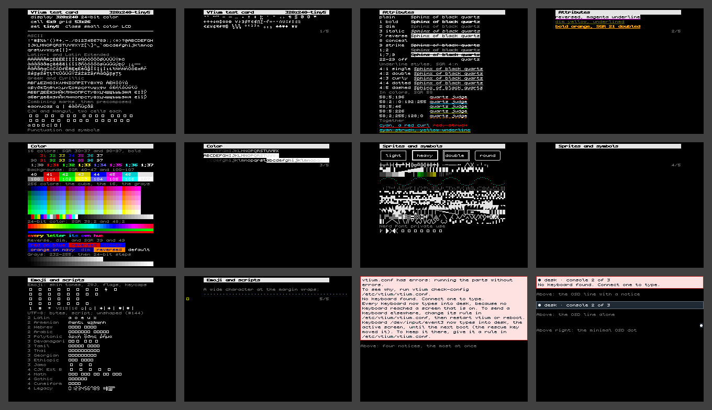](320x240-tiny5/collage.png) |
| [480x320](480x320/) | 24-bit color | 8×8 | 60×40 | `unscii-8` | 6 | accepted | [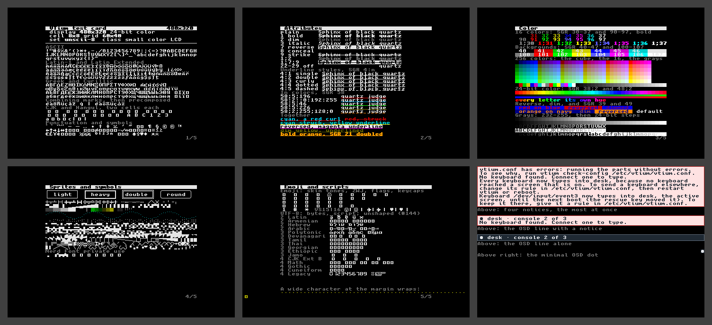](480x320/collage.png) |
| [640x480](640x480/) | 24-bit color | 8×16 | 80×30 | `unifont` | 4 | provisional | [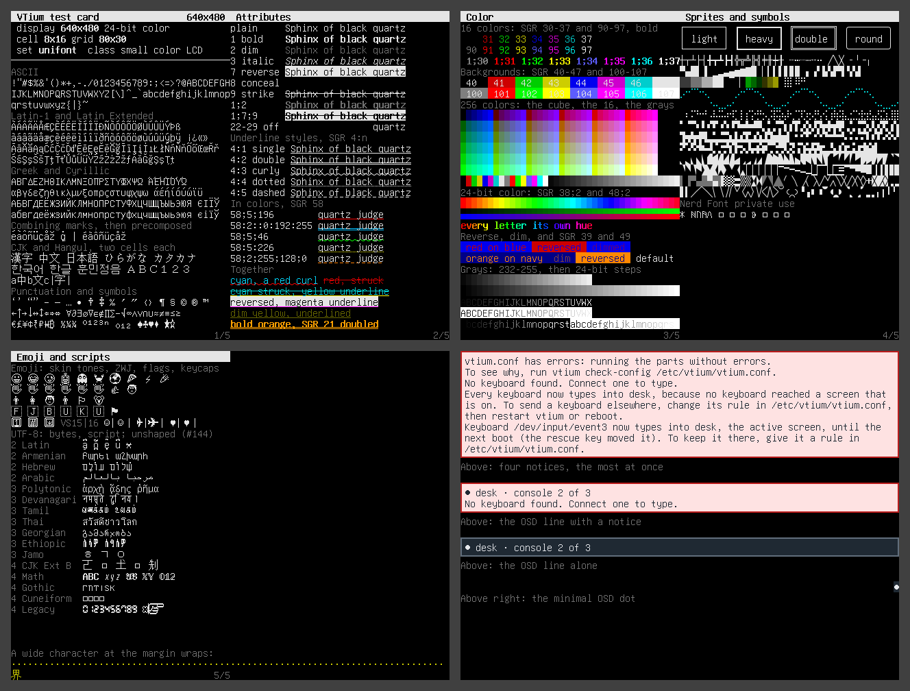](640x480/collage.png) |
| [800x480](800x480/) | 24-bit color | 8×16 | 100×30 | `unifont` | 4 | provisional | [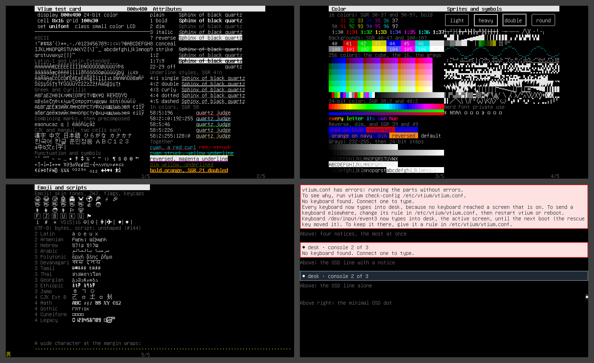](800x480/collage.png) |
| [1366x768](1366x768/) | 24-bit color | 8×16 | 170×48 | `unifont` | 3 | provisional | [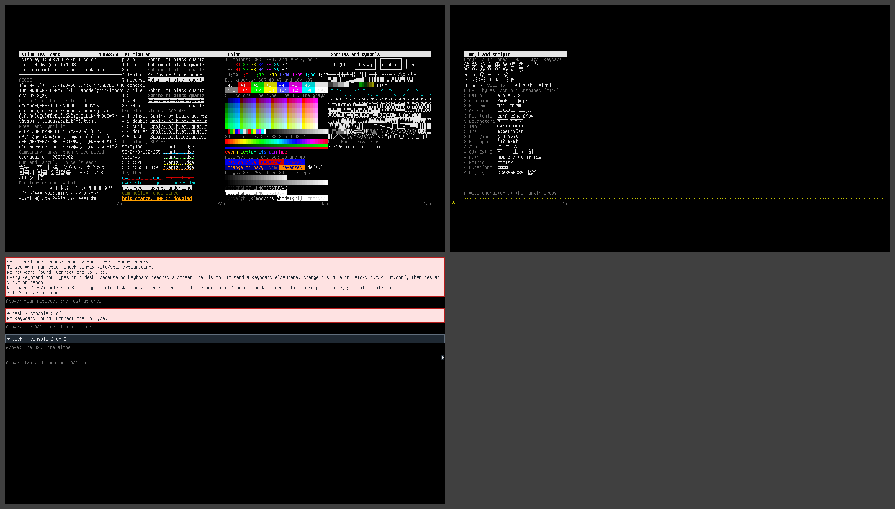](1366x768/collage.png) |
| [1920x1080](1920x1080/) | 24-bit color | 11×24 | 174×45 | `desktop` | 3 | accepted | [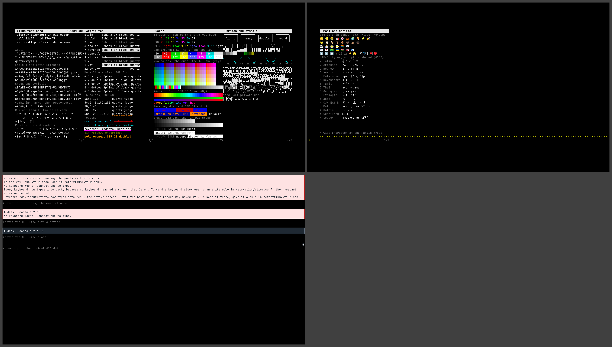](1920x1080/collage.png) |
| [2560x1440](2560x1440/) | 24-bit color | 14×32 | 182×45 | `desktop` | 3 | accepted | [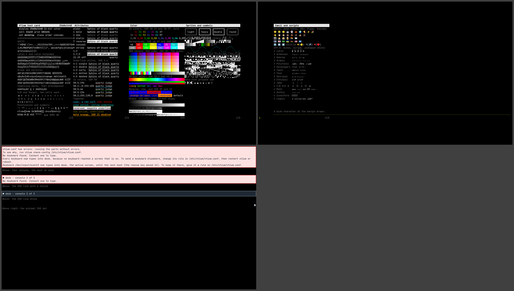](2560x1440/collage.png) |

`320x240-tiny5` shows an example font set, `tiny5`, the smallest font. vtium does not use it by default. vtium's own choice at 320×240 is the profile `320x240`.

A provisional profile waits on the operator's review, and `provisional.tsv` lists it: a drawing that moves it is reported as drift and fails nothing. An accepted profile fails on a moved pixel.

## Gray panels, simulated

vtium draws a gray panel exactly as it draws a color display, and the panel's driver converts each pixel. See [the issue about 1-bit and gray displays](https://github.com/vtium/vtium/issues/135). These renders take vtium's color drawing through that conversion, as Linux v7.3's drivers make it, to show what such a panel shows. They are simulations, not vtium's output, and judge nothing of vtium's drawing; a stale one is reported as its own kind of fault.

| Profile | Depth | Cell | Grid | Font | Screens | Status | Preview |
|---|---|---|---|---|---|---|---|
| [320x240-gray4](simulated/320x240-gray4/) | gray4, simulated | 8×8 | 40×30 | `unscii-8` | 7 | simulation | [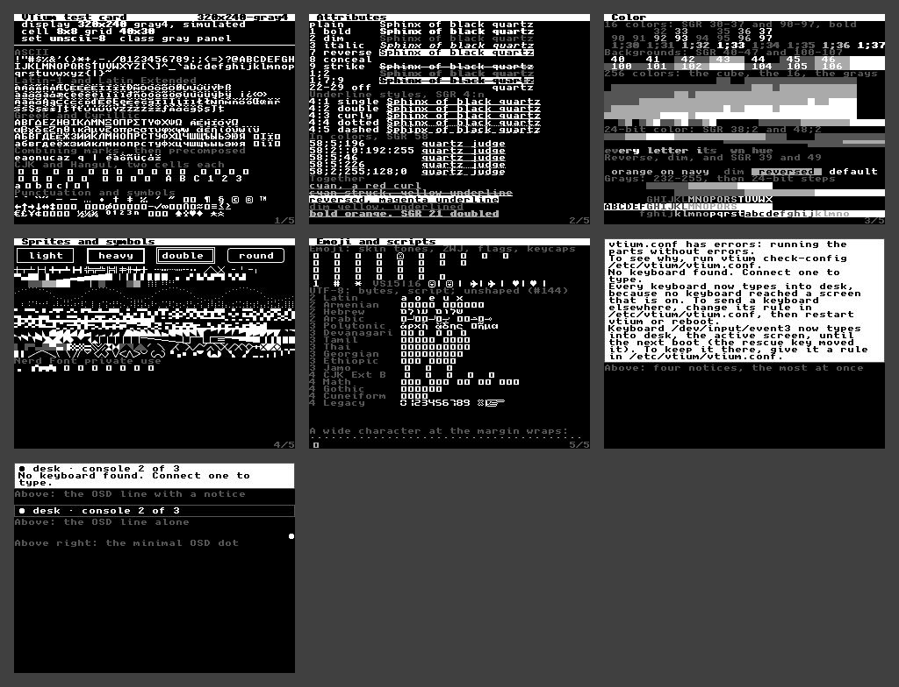](simulated/320x240-gray4/collage.png) |
| [320x240-gray16](simulated/320x240-gray16/) | gray16, simulated | 8×8 | 40×30 | `unscii-8` | 7 | simulation | [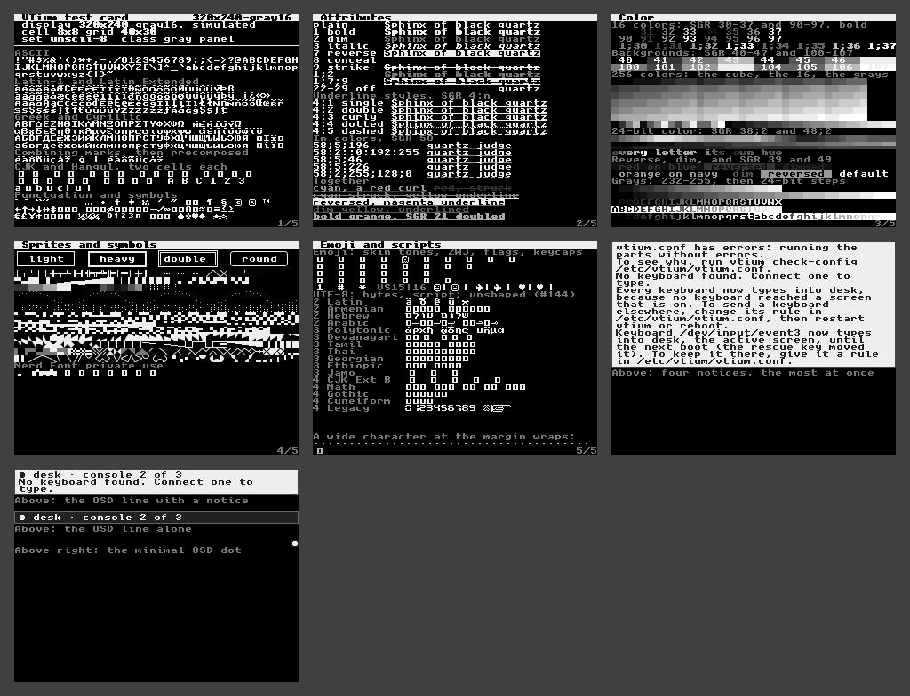](simulated/320x240-gray16/collage.png) |
| [640x480-gray16](simulated/640x480-gray16/) | gray16, simulated | 8×16 | 80×30 | `unifont` | 4 | simulation, provisional | [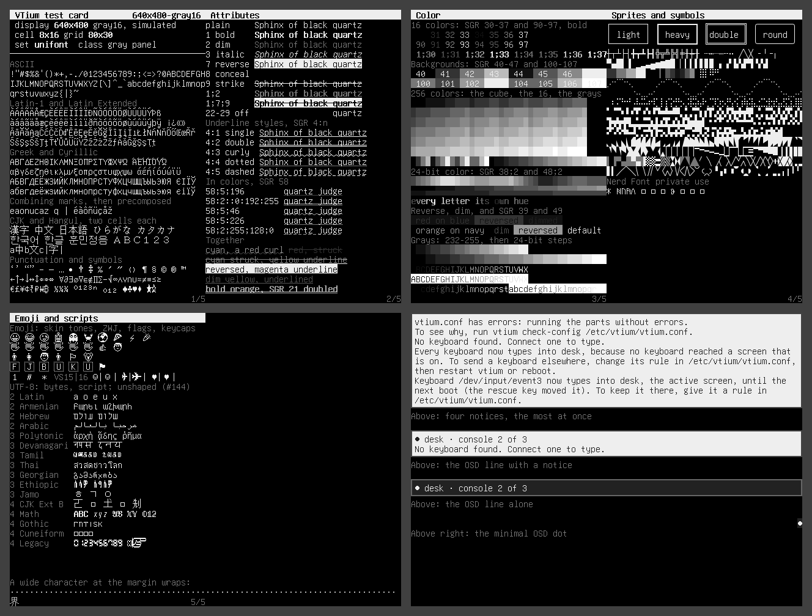](simulated/640x480-gray16/collage.png) |

## The card

The card is one byte stream of vtium's own, written by `tools/specimens`, in blocks of 40×30 cells. A block is one 320×240 screen at 8×8, and a page holds as many blocks as its grid fits, centered. A grid shorter than a block, such as the 53×26 that 6×9 cells give at 320×240, shows each block over more than one screen: the rows that fit, then the block's title again and the rows after them:

1. Text
2. Attributes
3. Color
4. Sprites and symbols
5. Emoji and scripts

`tools/specimens/README.md` lists what the card leaves out and why.

## The message bars

After the card, each profile draws vtium's message bars: its notices and its on-screen display. The console's own overlay code draws them, on one screen, or on two on the 320×240 displays, where the four notices fill a screen of their own. See [the on-screen display issue](https://github.com/vtium/vtium/issues/169) and [the heads tracker](https://github.com/vtium/vtium/issues/156). A display shows one box, across its top, so the screens stack four bands, each the top of a drawing of its own with a line beneath the bar saying what it is: four notices at once, the most a head shows; the on-screen display's full line sharing the box with a notice; the full line alone; and the minimal dot in the top-right cell.

## Drawing and judging

`make specimens` draws every file here from the profile table. `make specimens-check` draws them again and compares them with what is committed: an image by its pixels, a text by its bytes, and a file here that the table does not draw. A difference in an accepted profile fails; one in a provisional profile is drift, reported and not failed; a stale simulation is reported as its own kind of fault. Three profiles draw from fonts that `make specimens-fonts` fetches: the outline profiles `1920x1080` and `2560x1440`, and `320x240-tiny5`. CI's specimens job runs `make specimens-fonts` and then `make specimens-check`, so it judges every profile. `cargo test` runs the same check through `tools/specimens/tests/` but fetches no fonts: it judges every other profile and the text of all of them, and skips the images of those three, naming CI's specimens job as their judge. When `make specimens-check` cannot draw a profile because a pinned font is missing, it skips a provisional one with why and fails an accepted one. A branch that moves specimens regenerates them in their own commit, listing what moved; `provisional.tsv` is the only file here written by hand, and a conflict in the rest resolves by `make specimens-fonts && make specimens`.
