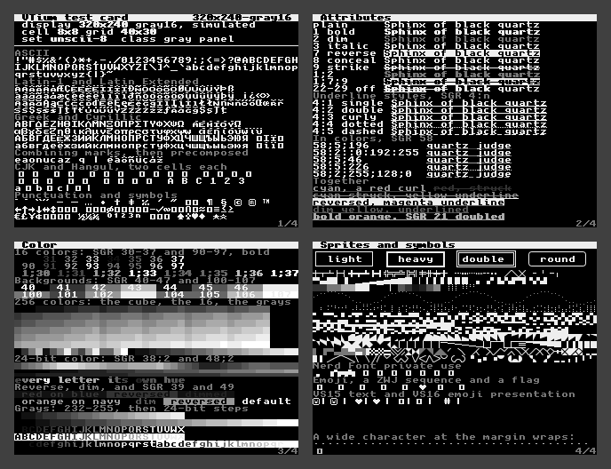

# 320x240-gray16 (simulated)

**A simulation of the panel's conversion, not vtium's output.** vtium draws this display as color; these screens are that drawing taken through the conversion the panel's Linux driver makes (v7.3): each pixel to gray8 by BT.601 luma, `(77r + 150g + 29b) / 256` (`drivers/gpu/drm/drm_format_internal.h:39-47`), then to the panel's levels as ssd130x's SSD132x path (`drivers/gpu/drm/solomon/ssd130x.c:968` and `:801-809`: gray8 >> 4, two 4-bit pixels a byte). Each level is drawn as the gray it is on a panel whose levels are evenly spaced. They judge nothing: `make specimens-check` reports a stale one apart from the specimens that judge vtium.

A 320x240 panel of 16 gray levels, as the SSD132x panels take: 320x240, gray16, simulated, drawn in `unscii-8` at 8x8, 40x30 cells, the card on 4 screens, shown together in the collage.



| Display | Class | Cell | Grid | Font | Screens |
|---|---|---|---|---|---|
| 320x240, gray16, simulated | gray panel | 8x8 | 40x30 | `unscii-8`, built in | [screen-1.png](screen-1.png), [screen-2.png](screen-2.png), [screen-3.png](screen-3.png), [screen-4.png](screen-4.png) |

## Why this font

vtium draws a gray panel exactly as a color display and lets the panel's driver convert each pixel (#135): the screens here are the color profile's drawing taken through the driver's arithmetic, a simulation of what the panel shows, not vtium's output. The font is the color profile's at this size, for the same reasons; a gray panel's few levels keep the bitmap glyphs crisp, and the card's gray bands show which levels survive the conversion.

## Configuration

[vtium.conf](vtium.conf):

```ini
# vtium's defaults: font-size=0 picks 8 pixels here (#118), which
# draws the built-in Unscii-8 (ADR-1200 D7). The panel converts.
font-size=0
```

The console chooses this set by itself once #126 and #118's rule land; the screens here draw vtium-font's built-in set directly.
