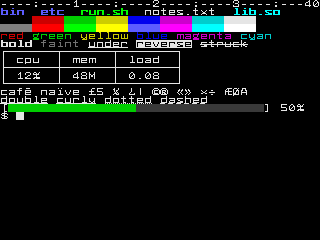

# VTium in depth

Using a computer means giving it instructions and seeing the results. You provide **input**, the computer **processes** it, and it produces **output**.

The way we interact with computers has changed over time. On early home computers such as the Apple II and Commodore 64, you typed on a keyboard and saw your words appear on the screen. On an IBM PC, you entered commands at the `C:\>` prompt. On a Macintosh, you could open a folder by clicking its icon. An iPhone responds to touch, while a VR headset changes your view as you turn your head. Each interface looks and feels different, but all follow the same pattern.

A terminal is a text-based version of this interaction. You type on a keyboard, a program reads what you enter, and its response appears as text on a screen.

Terminals have been central to Unix, and later Linux, from the beginning. You enter commands into a program called a shell, which runs them and displays the results. This way of working predates computer screens: early terminals were teletypes, electric typewriters connected to a computer. Linux still uses the name TTY, short for teletype, for its terminal devices.

What a terminal can display depends on its design. A teletype struck metal type against paper, so it could print only the characters built into its mechanism. Later terminals, such as DEC’s [VT102](https://en.wikipedia.org/wiki/VT100#Variants), displayed text on a screen using a fixed set of character shapes stored in a chip. That set included letters, digits, and line-drawing symbols, but it was still limited.

Modern desktop terminal emulators are much more flexible. They draw text in a window and support a wide range of fonts, millions of colors, and emoji. Underneath the desktop, Linux still provides several virtual terminals, or VTs. The desktop itself runs on one of them; others usually provide a text login prompt.

You can switch between VTs with Ctrl+Alt and a function key. Ctrl+Alt+F3 usually takes you to a text login prompt. The key that returns you to the desktop depends on your distribution; F1, F2, and F7 are common choices.

The kernel’s built-in text console has remained simple by design. It serves as a fallback when other parts of the system fail. A terminal connected through a serial port provides an even more basic way to access the machine.

That role is changing. Since Linux 6.10, the kernel has been able to display its own crash screen through modern graphics drivers. The Red Hat graphics developers behind that work describe the VT console as one of the [legacy parts of the kernel](https://fedoraproject.org/wiki/Changes/EnableDrmPanic) and propose replacing it with a console that runs as an ordinary program.

vtium is one such console. It takes the place of getty, the program that normally displays the login prompt on a VT, and adds full Unicode support, color emoji, and 24-bit color. It also supports the escape sequences that programs use to control terminal output, a convention dating back to terminals such as the VT100. If vtium cannot start, getty and the kernel console take over.

vtium is written in Rust and began as a port of `kmscon` and its library, `libtsm`, both written in C. See [Provenance](#provenance) for details.

## What it does

vtium renders directly to the display using one of two Linux interfaces: [KMS/DRM](https://en.wikipedia.org/wiki/Direct_Rendering_Manager), the modern graphics interface, or the older [fbdev framebuffer](https://en.wikipedia.org/wiki/Linux_framebuffer), which remains useful on some older or smaller machines.

Because vtium handles rendering itself, it does not need a display server—the software that manages graphical output for a desktop such as GNOME or KDE. It can render entirely on the CPU, so a GPU is optional.

Programs running in vtium get many of the features available in desktop terminals:

- 24-bit color and the 256-color palette; bold, faint, italic, and reversed text; and five underline styles.
- Unicode support, including double-width Chinese, Japanese, and Korean text and color emoji, using bitmap or outline fonts.
- Right-to-left text such as Arabic and Hebrew, laid out by the Unicode bidirectional algorithm, with Arabic letters joined and the cursor and selection following the text, when built with the `bidi` feature.
- Mouse reporting, bracketed paste, synchronized output, OSC 8 hyperlinks, and OSC 52 clipboard copying.
- Scrollback with a configurable byte limit and text that rewraps when the screen width changes.
- Images sent through sixel, the kitty graphics protocol, or iTerm2’s inline image protocol, when built with the `images` feature.

A single vtium process manages every display it finds. By default, it shows the same terminal on all of them. You can use `/etc/vtium/vtium.conf` to assign displays and keyboards to separate terminals, called *heads*. For example, one monitor could run a kiosk while another provides an operator’s shell. See [Set up heads](heads.md) for details.

The console process never opens font or image files directly. Instead, two helper programs handle them: `vtium-config serve` reads and rasterizes fonts, and `vtium-image` decodes images. Both run in sandboxes without root privileges. The console validates their output before rendering it.

The default build, called *minspec*, is intended for small machines. It renders on the CPU, uses bitmap fonts, and is tested in a virtual machine with one CPU, 512 MB of memory, and a display as small as 320×240.



*The minspec build on a 320×240 display, using an 8×8 bitmap font.*

[What vtium does](features.md) provides the full feature list, along with measured sizes and memory usage. [Why vtium](why-vtium.md#vtium-beside-the-alternatives) compares it with the kernel console, `kmscon`, fbterm, yaft, and fbpad, including features those alternatives offer that vtium does not.

## Status

See [the releases](https://github.com/vtium/vtium/releases) for the latest version and what changed in it.

- vtium runs as root, as getty does, so it can start the system’s login program. It currently opens the VT, graphics cards, and input devices directly. Support for obtaining those resources from a seat manager such as seatd or logind through libseat has been designed but is not yet complete.
- CPU rendering is the default. Builds with the `gpu` feature can use GPU rendering on heads where `hwaccel` is enabled.
- vtium is tested with systemd and sysvinit. Other init systems have not been tested. See [systemd, logind and PID 1](systemd.md).
- Ligatures, input methods, the kitty keyboard protocol, and configuration reloads without a restart are not yet implemented. See [Status](features.md#status) for the full list.

## Requirements

To run vtium, you need Linux with VTs enabled, a display supported through KMS/DRM or fbdev, and the `libxkbcommon` and `libudev` libraries. Builds with the `gpu` feature also require `libEGL` and `libgbm`, both provided by Mesa.

To build vtium, you need Rust 1.88 or later, clang, and `tic` from ncurses. The first build downloads a Debian sysroot for linking, allowing the resulting binaries to run on distributions with glibc 2.36 or newer.

## Try it

[Try vtium on one VT](tutorial-try-vtium.md) walks you through running vtium on a spare VT and restoring it afterward, while your desktop keeps running.

On Arch Linux, install the `vtium` package from the AUR. Installing the package does not start vtium automatically. To run it on VT 3 in place of getty, use:

```sh
# vtium console enable 3
```

To restore getty on VT 3, use:

```sh
# vtium console disable 3
```

On another distribution, you can run `make vt-shell` from a checkout of this repository. It builds vtium, selects a free VT, and runs your shell there until you exit. This method requires systemd and logind, prompts for sudo, and does not install anything. See [Without a package](tutorial-try-vtium.md#without-a-package) for details.

[Install vtium and give it VTs](install.md) covers other packages, build features, and installation from a repository checkout.

## Configuration

vtium reads its configuration from `/etc/vtium/vtium.conf`. If the file does not exist, it uses the defaults. Packages include `/etc/vtium/vtium.conf.example`, which lists every setting and its default value.

Run `vtium config tui` to open the full-screen configuration tool. It lets you inspect settings and preview fonts on the running console. Changes stay in a draft until you install them.

You can also validate a configuration file before installing it with `vtium check-config FILE`. [Configure vtium](configure.md) explains both tools.

## Testing

vtium’s tests compare screen output and responses to terminal queries against saved expected results, using both text comparisons and pixel-by-pixel image checks.

The tests run in tiers, from unit tests to virtual machine tests that boot vtium on a real VT and capture its screen. [How vtium is judged](concepts/how-vtium-is-judged.md) explains each tier.

## Provenance

vtium began as a Rust port of two C projects: `kmscon`, a Linux console terminal written by David Herrmann and contributors, and `libtsm`, its terminal library, by Aetf, David Herrmann, and Ran Benita.

The console and libraries now consist of Rust code written for vtium. [COPYING](https://github.com/vtium/vtium/blob/main/COPYING) preserves the original author credits and notices.
